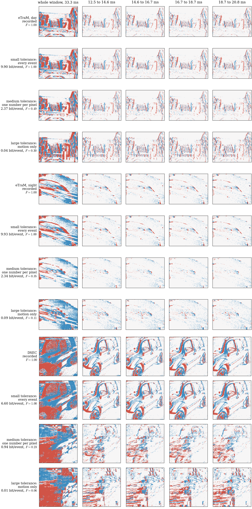

```
directive: 024
status: DONE
executed_commit: 0e6e56f
results: results/td/demo.json, results/td/demo.npz, results/td/choice.json, results/paper/fig_tolerance.{pdf,png,json}
```

## 1. What ran

1. **Files (D-024-1).** Appendices A to C were written to `ec/tolerance_demo.py`, `scripts/fig_tolerance.py` and
   `tests/test_tolerance_demo_gate.py`, each as the text between the fence lines plus one newline (commit
   `f294039`). All three SHA-256 match Section 7.
2. **Runner (D-024-2).** `scripts/td_run.py` (commit `0e6e56f`) reuses the group list of `hd_run.groups(ds,
   "d2")` (the groups of directive 022). It reads the events of `[(w - 3) T0, (w + 2) T0)` as `ph_run` does:
   - eTraM: one `bk_run.read` per recording, at most six reads at once under the read lock;
   - DSEC: the caches of directive 017, through `fm_run.dsec_events`.
   
   Tracks come from `rc_run.load_tracks`: eTraM train annotations of the population, and DSEC-Detection with
   the `minus_t_offset` time base of directive 017 (`t_offset` from `rc_run.t_offset_of`, as in 018, 019 and
   021). `scripts/sync_cnt.sh` now also refuses to sync while a `td_` worker runs.
3. **Choice (Section 4)** on `cnt`, under `nice -n 19` with one BLAS thread:
   - Scope: 136 recordings (eTraM 55 day, 45 night; DSEC 36) and 1,264 groups, at most 6 workers, 0.65 CPU-h,
     16 minutes, no failed task.
   - For each group, every box of `ec.regions.boxes_at(tracks, w + 1, W, H)` gets the count of the events
     of window `w + 1` with `x0 <= x < x0 + bw` and `y0 <= y < y0 + bh`, after the hot-pixel rule. The rule is
     applied exactly as `ec.tolerance_demo.demo` applies it: `th.hot_pixels` on `[(w - 3) T0, (w + 1) T0)`.
   - 234 groups had no box alive at the centre of `w + 1`.
   - The box with the most events wins, with ties to the earliest recording in population order, then the
     smallest `w`, then the smallest track id. No tie occurred at the top of any stratum.
4. **Demo (Section 5)** on `cnt`: `ec.tolerance_demo.demo(events, w, W, H, box)` for each chosen object, then
   `ec.tolerance_demo.save({"day": ..., "night": ..., "all": ...}, ...)` and
   `python3 scripts/fig_tolerance.py --demo ... --out ...`. Here `events` covers `[(w - 3) T0, (w + 2) T0)`.
   The outputs were copied unchanged to `results/td/` and `results/paper/`. On the host, `fig_tolerance.py`
   needs its `--out` directory to exist; in the repository `results/paper/` exists.
5. **Suite** on `cnt` at `0e6e56f`: 172 tests, 0 failures, 0 errors, 0 skipped (from `--junitxml`). The
   suite had 166 tests at directive 023 (report 023); the gate of Appendix C adds 6 tests (`test_*`
   functions). The directive's count of 167 was taken on the director's checkout, which is not this one;
   the difference was not traced further, since no test is skipped or failing.

Versions on `cnt`: Python 3.10.12, numpy 1.26.4, scipy 1.15.3, matplotlib 3.5.1, zstandard 0.25.0,
numba 0.60.0.

## 2. The chosen objects (Section 4)

The box is `(x, y, w, h)` in pixels, as `boxes_at` returns it, clipped to the sensor. The crop is that of
`ec.tolerance_demo.crop_of(clip_box(box))`. It holds the central 240 x 180 pixels of the box at most, plus a
16 px margin.

| stratum | recording | population index | j | w | track id | box (x, y, w, h) | events in box, window w + 1 | boxes compared | crop (x0, y0, x1, y1) | events in crop |
|---|---|---|---|---|---|---|---|---|---|---|
| eTraM, day | `train_day_0007_td` | 5 | 50 | 4530 | 55 | (2.35, 483.15, 1148.66, 213.26) | 422,111 | 1,111 | (440, 483, 713, 696) | 125,274 |
| eTraM, night | `train_night_0038_td` | 88 | 5 | 480 | 49 | (233.24, 442.82, 516.10, 254.36) | 193,596 | 1,270 | (355, 464, 628, 677) | 73,648 |
| DSEC | `interlaken_00_f` | 2 | 20 | 1230 | 572 | (0.00, 159.48, 192.79, 288.98) | 517,752 | 1,278 | (0, 197, 209, 410) | 433,495 |

The rule favours large boxes, and the day box spans almost the full sensor width (1,149 px). The demo
therefore shows its central 240 x 180 px, which is part of the scene the box covers, not one whole object.
The same holds less strongly for the night box. The DSEC box (193 x 289 px) is a car near the left edge.

## 3. Bits per event and F per stratum and reconstruction

Bits are per true event of the crop. F is Eq. (fid) inside the crop on (1 px, T0 / k).

| stratum | reconstruction | events | bits per event | F, k3 | F, k32 | F, k256 |
|---|---|---|---|---|---|---|
| eTraM, day | recorded | 125,274 | n/a | 1.000 | 1.000 | 1.000 |
| | every event | 125,274 | 9.903 | 0.998 | 1.000 | 1.000 |
| | one number per pixel | 121,509 | 2.370 | 0.708 | 0.490 | 0.108 |
| | motion only | 164,451 | 0.043 | 0.567 | 0.299 | 0.042 |
| eTraM, night | recorded | 73,648 | n/a | 1.000 | 1.000 | 1.000 |
| | every event | 73,648 | 9.934 | 0.998 | 1.000 | 1.000 |
| | one number per pixel | 42,125 | 2.340 | 0.501 | 0.350 | 0.093 |
| | motion only | 62,949 | 0.090 | 0.328 | 0.108 | 0.022 |
| DSEC | recorded | 433,495 | n/a | 1.000 | 1.000 | 1.000 |
| | every event | 433,495 | 6.605 | 0.997 | 1.000 | 1.000 |
| | one number per pixel | 291,616 | 0.941 | 0.376 | 0.226 | 0.075 |
| | motion only | 363,695 | 0.014 | 0.240 | 0.064 | 0.016 |

Motion parameters were coded for 154, 165 and 132 blocks, and pixel symbols for 51,326, 27,848 and 59,001
pixel-polarity pairs (day, night, DSEC).

Readings, stated without going beyond the numbers:

- **Bits fall by about two orders of magnitude per regime:**
  - every event: 6.6 to 9.9 bits per event;
  - one number per pixel: 0.9 to 2.4;
  - motion only: 0.01 to 0.09.
- **Every event keeps F = 1 on k32 and k256, but F is 0.997 to 0.998 on k3.** The times are placed at the
  middle of bins of T0 / 256 (130 us). The k3 grid has its boundaries at multiples of T0 / 3 (11,111 us),
  which do not fall on bin edges. An event close to such a boundary can therefore be placed on its other side.
- **On recordings, the two lower regimes are well below the model figures of Section 2.** At (1 px, T0 / 32),
  the model gave 0.79 for one number per pixel and 0.46 for motion only (independent phases). The recordings
  give:

  | reconstruction | day | night | DSEC |
  |---|---|---|---|
  | one number per pixel | 0.49 | 0.35 | 0.23 |
  | motion only | 0.30 | 0.11 | 0.06 |

  F also falls from k3 to k256 in every stratum.
- **On DSEC, the figure shows blocky, block-aligned patterns in the two lower regimes.** They appear in the
  whole-window frame and in the slices, and the recorded frame does not have them. Their cause was not
  examined, since the directive asks for no diagnosis.

## 4. Figure



`results/paper/fig_tolerance.png`, `.pdf` and `.json`. The figure has 12 rows: per stratum, recorded, then
every event, one number per pixel and motion only. It has 5 columns: the whole window of 33.3 ms, then four
slices of 2.08 ms each, from 12.5 to 20.8 ms. The F in the row labels is on k32.

## 5. Acceptance checks

| # | check | outcome |
|---|---|---|
| 1 | SHA-256 of Section 7; suite passes with no skipped test | **PASS**. `ec/tolerance_demo.py` `49fb2944...ddf13e0c`, `scripts/fig_tolerance.py` `0e07a35a...c6e853`, `tests/test_tolerance_demo_gate.py` `3a03e38c...5e48d2`. Suite at `0e6e56f` on `cnt`: 172 tests, 0 failures, 0 errors, 0 skipped |
| 2 | `results/td/demo.{json,npz}` and `results/paper/fig_tolerance.{pdf,png,json}` exist; `recorded` has F = 1 on every grid | **PASS**. All five files exist. `recorded` F = 1.0 on k3, k32 and k256 for day, night and DSEC |
| 3 | no eTraM val or test file opened, annotation root not listed; nothing else changed under `results/` | **PASS**. Event reads: `bk_run.read` on the 100 eTraM population recordings of the 022 groups, and the 36 DSEC caches of 017. Annotations: opened by path, through `mp.annotation_path(rid)`, for the same 100 recordings. DSEC `tracks.npy` and the `t_offset` field of `events.h5` were opened for the 36 sequences. No directory was listed. The report commit adds only `results/td/` (`demo.json`, `demo.npz`, `choice.json`) and `results/paper/fig_tolerance.{pdf,png,json}` under `results/` |

Host files: candidates and logs under `/data/<user>/event_coding/home/td/`, symlinked from
`~/prjs/event_coding/td`. Nothing was written in a companion-project directory.
