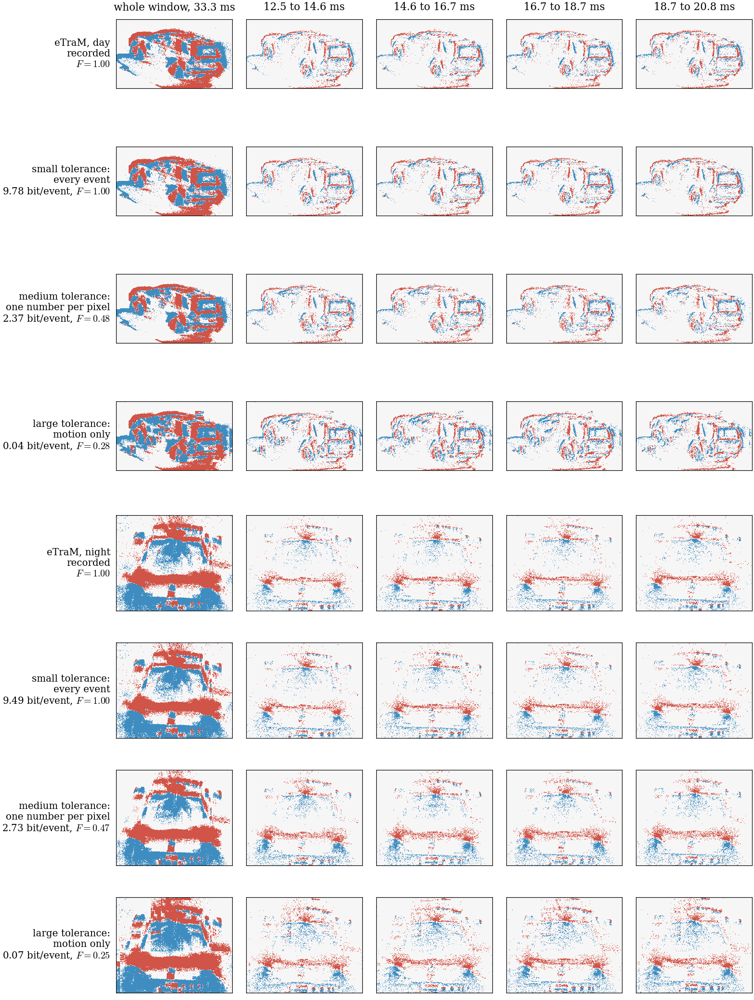

```
directive: 025
status: DONE
executed_commit: 51125ff
results: results/td2/demo.json, results/td2/demo.npz, results/td2/choice.json, results/td2/fig_tolerance.{pdf,png,json}
```

## 1. What ran

1. **Files (D-025-1).** Appendices A and B replaced `ec/tolerance_demo.py` and
   `tests/test_tolerance_demo_gate.py`, each as the text between the fence lines plus one newline. Both SHA-256
   match Section 7. `scripts/fig_tolerance.py` is unchanged from directive 024.
2. **Runner (D-025-2).** `scripts/td_run.py` gained `--directive 025`, which:
   - reuses the reads and track loading of directive 024: `bk_run.read` under the six-slot read lock, and
     eTraM train annotations of the population through `rc_run.load_tracks`;
   - covers eTraM only, in two strata, day and night;
   - gives each box of `boxes_at(tracks, w + 1, W, H)` its `box_before`: the box of the same track id in
     `boxes_at(tracks, w, W, H)`, or None;
   - records `ec.tolerance_demo.eligible(box, box_before, W, H)` and the displacement of the box centre.
   
   The 024 mode is unchanged in what it computes.
3. **Choice (Section 4)** on `cnt`, under `nice -n 19` with one BLAS thread:
   - Scope: the 100 eTraM recordings of the 022 groups, at most 6 workers, 0.83 CPU-h, 11 minutes, no failed
     task.
   - Boxes: 2,381 in all, the same number as in directive 024. Of these, 130 have no box of the same track at
     `w`, and 153 are eligible: 88 by day, 65 at night.
   - Counting: the events of window `w + 1` with `x0 <= x < x0 + bw` and `y0 <= y < y0 + bh`, after the
     hot-pixel rule as `demo` applies it.
   - Selection: the eligible box with the most events wins. Ties go to the earliest recording in population
     order, then the smallest `w`, then the smallest track id. No tie occurred at the top.
4. **Demo (Section 5)** on `cnt`, at `51125ff`:
   - `ec.tolerance_demo.demo(events, w, W, H, box, fit="same")`, where `events` covers
     `[(w - 3) T0, (w + 2) T0)`;
   - then `ec.tolerance_demo.save({"day": ..., "night": ...}, ...)` and
     `python3 scripts/fig_tolerance.py --demo ... --out ...` into one directory.
   
   The runner checks `eligible` again before each demo. The outputs, with the choice record `choice.json`,
   were copied unchanged to `results/td2/`.
5. **Suite** on `cnt` at `51125ff`: 174 tests, 0 failures, 0 errors, 0 skipped (from `--junitxml`). This is
   the 172 tests of directive 024 plus the 2 tests that Appendix B adds (the gate went from 6 to 8 `test_*`
   functions). The directive's count of 169 was taken on the director's checkout; the difference is the same
   5 tests as in report 024.

Versions on `cnt`: Python 3.10.12, numpy 1.26.4, scipy 1.15.3, matplotlib 3.5.1, zstandard 0.25.0,
numba 0.60.0.

## 2. The chosen objects (Section 4)

The boxes are `(x, y, w, h)` in pixels. The displacement is that of the box centre from `box_before` (at `w`)
to `box` (at `w + 1`). Both boxes fit the crop whole (at most 240 x 180) and lie at least 32 px inside the
1280 x 720 sensor.

| stratum | recording | population index | j | w | track id | box at w + 1 | box at w | displacement (dx, dy), length | events in box | eligible boxes compared |
|---|---|---|---|---|---|---|---|---|---|---|
| eTraM, day | `train_day_0010_td` | 8 | 50 | 4530 | 189 | (850.88, 153.80, 239.35, 128.87) | (861.23, 158.43, 242.66, 130.54) | (-12.01, -5.47), 13.19 px | 80,281 | 88 |
| eTraM, night | `train_night_0022_td` | 73 | 45 | 4080 | 106 | (448.14, 450.45, 196.82, 155.12) | (446.05, 459.16, 199.12, 154.82) | (0.95, -8.57), 8.62 px | 58,594 | 65 |

The crops are (834, 137, 1107, 299) by day and (432, 434, 661, 622) at night, as (x0, y0, x1, y1). They hold
87,521 and 70,459 events of window `w + 1`. Both panels show one whole car:
- **day:** a side view, moving left;
- **night:** a front or rear view, moving up the image.

## 3. Bits per event and F per reconstruction (`fit = "same"`)

Bits are per true event of the crop. F is Eq. (fid) inside the crop on (1 px, T0 / k).

| stratum | reconstruction | events | bits per event | F, k3 | F, k32 | F, k256 |
|---|---|---|---|---|---|---|
| eTraM, day | recorded | 87,521 | n/a | 1.000 | 1.000 | 1.000 |
| | every event | 87,521 | 9.777 | 0.998 | 1.000 | 1.000 |
| | one number per pixel | 93,222 | 2.370 | 0.735 | 0.476 | 0.101 |
| | motion only | 116,122 | 0.043 | 0.612 | 0.283 | 0.038 |
| eTraM, night | recorded | 70,459 | n/a | 1.000 | 1.000 | 1.000 |
| | every event | 70,459 | 9.491 | 0.998 | 1.000 | 1.000 |
| | one number per pixel | 79,456 | 2.728 | 0.752 | 0.465 | 0.105 |
| | motion only | 92,448 | 0.066 | 0.641 | 0.248 | 0.038 |

The motion parameters cover 135 blocks by day and 143 at night. The pixel symbols cover 33,297 and 28,663
pixel-polarity pairs.

Readings:

- **The bits per event fall by two orders of magnitude per regime:** from 9.5 to 9.8 (every event), to 2.4 to
  2.7 (one number per pixel), to 0.04 to 0.07 (motion only).
- **Every event keeps F = 1 on k32 and k256; on k3 it gives 0.998.** The cause is the one stated in report
  024: times placed at the middle of T0 / 256 bins can cross a T0 / 3 boundary.
- **The day car comes close to the model's 13.3 px per window, but scores lower.** It moved 13.2 px. At
  (1 px, T0 / 32) the model with `fit = "same"` gave 0.80 (one number per pixel) and 0.48 (motion only). The
  car gives 0.48 and 0.28. The night car (8.6 px) gives 0.47 and 0.25.
- **No causal fit was run on these two objects,** since the directive does not ask for one. So this report
  does not say how much `fit = "same"` gains on them.
- **The 024 objects are not comparable.** Its night F values (0.35 and 0.11 on k32) were measured on another
  object, with the causal fit.
- **In the figure, the whole-window frames of the four rows look alike.** In the 2 ms slices, "motion only"
  spreads the edges of the car over more pixels than the recorded slice. "One number per pixel" is closer to
  the recorded slice.

## 4. Figure



`results/td2/fig_tolerance.png`, `.pdf` and `.json`. The figure has 8 rows: per stratum, recorded, then every
event, one number per pixel and motion only. It has 5 columns: the whole window of 33.3 ms, then four slices
of 2.08 ms from 12.5 to 20.8 ms. The F in the row labels is on k32.

## 5. Acceptance checks

| # | check | outcome |
|---|---|---|
| 1 | SHA-256 of Section 7; suite passes with no skipped test | **PASS**. `ec/tolerance_demo.py` `1a0e1eea...c0d1f719`, `tests/test_tolerance_demo_gate.py` `2d0931de...2f979749`. Suite at `51125ff` on `cnt`: 174 tests, 0 failures, 0 errors, 0 skipped |
| 2 | the six files of `results/td2/` exist; both boxes satisfy `eligible`; `recorded` has F = 1 on every grid | **PASS**. All six files exist. `eligible(box, box_before, 1280, 720)` is True for day and night, both in the runner and when recomputed from `results/td2/choice.json`. `recorded` F = 1.0 on k3, k32 and k256 for both strata |
| 3 | no eTraM val or test file opened, annotation root not listed; nothing outside `results/td2/` changed under `results/` | **PASS**. Reads: `bk_run.read` and annotations opened by path (`mp.annotation_path(rid)`) for the 100 eTraM population recordings of the 022 groups, and nothing else. No directory was listed. No DSEC file was read. Under `results/`, the report commit adds only the six files of `results/td2/`; the files of directive 024 are untouched |

Host files: candidates under `/data/<user>/event_coding/home/td/cand2/` and outputs under `.../td/out2/`, both
reached through the symlink `~/prjs/event_coding/td`. Nothing was written in a companion-project directory.
