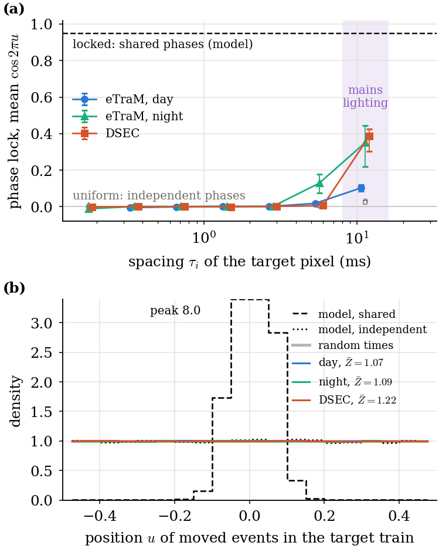
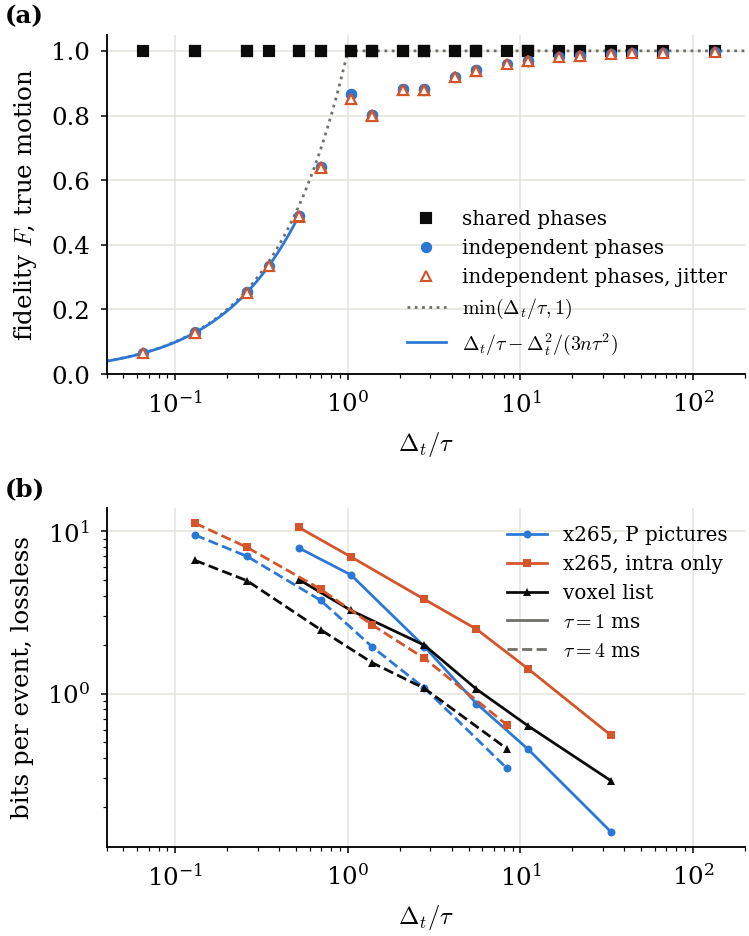

```
directive: 027
status: DONE
executed_commit: 59d0a6e (run), f4bf428 (reduction)
results: results/pc/report.json, results/pc/provenance.json, results/pc/checks.json,
         results/paper/fig_moved2.{pdf,png,json}, results/paper/fig_phase3.{pdf,png,json},
         results/paper/fig_tolerance_compact2.{pdf,png,json}, results/paper/fig_hevc2.{pdf,png,json}
```

## Reading of Table 1

Under the pre-set rule of Section 6, **every stratum reads "no lock within blocks"**: the 95% interval of the
mean Z of `pred` lies entirely below 2.

| stratum | mean Z, `pred` | 95% interval | reading |
|---|---|---|---|
| eTraM, day | 1.067 | [1.021, 1.132] | no lock within blocks |
| eTraM, night | 1.094 | [1.057, 1.135] | no lock within blocks |
| DSEC | 1.216 | [1.037, 1.462] | no lock within blocks |

The test can see a lock where one exists. The model scenes with shared phases give a mean Z of 63.8, and
99.0% of their blocks have Z > ln 100. Those with independent phases give 1.045. On recordings the `pred`
intervals lie slightly above 1, and above their `null` (random times, 0.997 to 1.007). Only 1.1% to 1.7% of
blocks pass Z > ln 100, against 0.75% to 0.95% for the null. The test covers 33%, 27% and 27% of the true
events of the scored window (day, night, DSEC), and 29%, 20% and 19% within the spacing band (Table 2).

The control (Table 3) carries the causal claim on the model:
- With the same edges, exact motion and the same events per pixel, shared phases give F = 1 in all 36 cells.
- Independent phases follow Eq. (binfidmoved) within 0.0004 in the 6 cells where it applies.
- Jitter of 0.05 tau changes F by at most 0.0162 (tau = 0.5 ms, k64).

## 1. What ran

1. **Files (D-027-1).** Appendices A to C were written to `ec/phase_control.py`,
   `tests/test_phase_control_gate.py` and `scripts/fig_027.py`, each as the text between the fence lines plus
   one newline (commit `59d0a6e`). All three SHA-256 match Section 11.
2. **Runner (D-027-2).** `scripts/pc_run.py` reuses the group list and event reads of `scripts/ph_run.py`:
   - the D2 groups (`hd_run.groups(ds, "d2")`) and the events of `[(w - 3) T0, (w + 2) T0)`;
   - eTraM read once per recording with `bk_run.read`, at most six at once under the read lock of directive 016;
   - DSEC from the caches of directive 017.
   
   Per group it calls `ec.phase_control.block_phases(events, w, W, H)`. Per model scene it calls
   `block_phases(ev, 5, 320, 240)` on `ec.phase.edge_scene_v(320, 240, v, 2000.0, 3, 0.05, 40, 8, seed,
   shared)`. Per control cell it calls `control_cell(tau, condition)` with its defaults. Worker numbers follow
   the memory guard (40 GB free) and `_target_workers` of directive 016, up to 22.
   `scripts/sync_cnt.sh` now also refuses to sync while a `pc_` worker runs.
3. **Projection (Section 7)** from the first 10 groups of each dataset: **2.19 CPU-h**, against the limit of 40.

   | part | CPU-h |
   |---|---|
   | eTraM | 1.07 |
   | DSEC | 0.86 |
   | model scenes | 0.04 |
   | control cells | 0.22 |

   The run went on.
4. **Run** on `cnt` at `59d0a6e`, under `nice -n 19` with one BLAS thread:
   - 178 tasks (18 control cells, 24 model scenes, 136 recordings), with no failure;
   - wall time 11.5 minutes (21:21 to 21:33 UTC), 2.37 CPU-h in all;
   - outputs under `~/prjs/event_coding/pc/` for eTraM, model and control (a symlink into
     `/data/<user>/event_coding/home/pc/`), and under `/data/<user>/event_coding/ds/pc/` for DSEC.
   
   No companion-project (`sbc_`) job was running. Another job of the same user (`carla_014`, another project)
   occupied the cores; this run's niced workers did not displace it.
5. **Reduction** on `cnt` at `f4bf428`:
   - `scripts/pc_reduce.py` writes `results/pc/report.json` with exactly the keys of Section 6.
     `model_phase.<kind>` also carries `rayleigh_null` and `n_scenes`, for Table 1.
   - It writes `results/pc/checks.json` with the reading and checks 2 to 5.
   - `scripts/pc_provenance.py` writes `results/pc/provenance.json`.
   
   The first reduction at `bff8887` failed on a numpy bool in `checks.json`; `f4bf428` fixes only that.
6. **Figures (Section 8).** These ran on the laptop (matplotlib 3.10.9, numpy 2.4.4), after `results/pc/` was
   committed (`12708e6`):

   ```
   python3 scripts/fig_027.py --pc results/pc --hd results/hd --hc results/hc --demo results/td2 --paper results/paper --out results/paper
   ```
7. **Suite** on `cnt` at `59d0a6e`: 179 tests, 0 failures, 0 errors, 0 skipped (from `--junitxml`).
   - The first attempt had 1 failure: `test_pool_and_figures` reads the committed `results/paper/fig_phase2.json`.
     `sync_cnt.sh` never sends `results/`, so that file was missing on `cnt`.
   - After the committed `results/{paper,td2,hd,hc}` were copied into the host checkout, the full suite passed.
   - The director's count is not stated in this directive.

## 2. Table 1: the per-block phase test

Blocks with at least 5 tested pixels (`M_MIN`). Z is the Rayleigh statistic `|sum exp(2 pi i u)|^2 / m` per
block. The interval comes from a bootstrap over recordings (scenes for the model), with 2000 resamples and
seed 20261016.

| stratum | recordings | groups | kind | blocks | pixels | mean Z | 95% interval | share Z > ln 100 |
|---|---|---|---|---|---|---|---|---|
| eTraM, day | 55 | 563 | pred | 15,028 | 1,148,835 | 1.067 | [1.021, 1.132] | 0.0113 |
| eTraM, day | 55 | 563 | null | 15,028 | 1,148,835 | 0.997 | [0.979, 1.015] | 0.0095 |
| eTraM, night | 45 | 448 | pred | 6,933 | 353,733 | 1.094 | [1.057, 1.135] | 0.0154 |
| eTraM, night | 45 | 448 | null | 6,933 | 353,733 | 1.007 | [0.987, 1.027] | 0.0075 |
| DSEC | 36 | 253 | pred | 44,715 | 2,681,912 | 1.216 | [1.037, 1.462] | 0.0167 |
| DSEC | 36 | 253 | null | 44,715 | 2,681,912 | 0.999 | [0.990, 1.008] | 0.0083 |
| model, shared phases | 12 scenes | 12 | pred | 1,116 | 76,470 | 63.834 | [40.454, 88.953] | 0.9901 |
| model, shared phases | 12 scenes | 12 | null | 1,116 | 76,470 | 1.045 | [0.998, 1.097] | 0.0054 |
| model, independent phases | 12 scenes | 12 | pred | 1,116 | 76,288 | 1.045 | [0.997, 1.087] | 0.0125 |
| model, independent phases | 12 scenes | 12 | null | 1,116 | 76,288 | 0.969 | [0.946, 0.990] | 0.0081 |

## 3. Table 2: coverage

True events of the scored window `w + 1`, summed over the groups of the stratum:
- `moving`: in a moving block that passed the selection;
- `tested`: of a pixel with a phase;
- `band`: of such a pixel inside the spacing band and outside the flicker classes, the pixels of Table 1.

| stratum | n_true_window | n_true_moving | n_true_tested | n_true_band | share_tested | share_band |
|---|---|---|---|---|---|---|
| eTraM, day | 24,745,381 | 21,851,188 | 8,159,230 | 7,161,259 | 0.3297 | 0.2894 |
| eTraM, night | 16,717,820 | 12,306,461 | 4,437,098 | 3,275,118 | 0.2654 | 0.1959 |
| DSEC | 110,182,920 | 96,917,851 | 30,104,133 | 21,142,899 | 0.2732 | 0.1919 |

## 4. Table 3: the controlled model

F of the counts moved along the true motion (one-pixel voxels, grid T0 / k). The model has 320 x 240 pixels,
6 px per window, n = 3, spacing 40, 12 windows and seed 1. In brackets is Eq. (binfidmoved), where it
applies (dt <= tau / 2). The value dt / tau = (T0 / k) / tau is in `report.json#/control/*/dt_over_tau`; for
example, it is 0.26 at tau = 2 ms and k = 64.

| tau (ms) | condition | k1 | k3 | k6 | k12 | k32 | k64 |
|---|---|---|---|---|---|---|---|
| 0.25 | shared | 1.0000 | 1.0000 | 1.0000 | 1.0000 | 1.0000 | 1.0000 |
| 0.25 | independent | 0.9975 | 0.9924 | 0.9849 | 0.9699 | 0.9200 | 0.8811 |
| 0.25 | jitter | 0.9974 | 0.9922 | 0.9844 | 0.9692 | 0.9188 | 0.8782 |
| 0.5 | shared | 1.0000 | 1.0000 | 1.0000 | 1.0000 | 1.0000 | 1.0000 |
| 0.5 | independent | 0.9949 | 0.9850 | 0.9697 | 0.9396 | 0.8816 | 0.8680 |
| 0.5 | jitter | 0.9948 | 0.9848 | 0.9693 | 0.9390 | 0.8788 | 0.8519 |
| 1 | shared | 1.0000 | 1.0000 | 1.0000 | 1.0000 | 1.0000 | 1.0000 |
| 1 | independent | 0.9900 | 0.9699 | 0.9402 | 0.8802 | 0.8678 | 0.4896 |
| 1 | jitter | 0.9898 | 0.9694 | 0.9392 | 0.8784 | 0.8516 | 0.4875 |
| 2 | shared | 1.0000 | 1.0000 | 1.0000 | 1.0000 | 1.0000 | 1.0000 |
| 2 | independent | 0.9800 | 0.9399 | 0.8807 | 0.8007 | 0.4905 | 0.2526 (0.2529) |
| 2 | jitter | 0.9797 | 0.9391 | 0.8790 | 0.7993 | 0.4892 | 0.2510 (0.2529) |
| 4 | shared | 1.0000 | 1.0000 | 1.0000 | 1.0000 | 1.0000 | 1.0000 |
| 4 | independent | 0.9601 | 0.8808 | 0.8018 | 0.6413 | 0.2531 (0.2529) | 0.1285 (0.1283) |
| 4 | jitter | 0.9595 | 0.8794 | 0.8010 | 0.6400 | 0.2514 (0.2529) | 0.1266 (0.1283) |
| 8 | shared | 1.0000 | 1.0000 | 1.0000 | 1.0000 | 1.0000 | 1.0000 |
| 8 | independent | 0.9204 | 0.8009 | 0.6405 | 0.3340 (0.3338) | 0.1287 (0.1283) | 0.0647 (0.0646) |
| 8 | jitter | 0.9188 | 0.7991 | 0.6390 | 0.3331 (0.3338) | 0.1273 (0.1283) | 0.0639 (0.0646) |

## 5. Figures

- `fig_moved2`: (a) is the control above; (b) is the HEVC bits as before.
- `fig_phase3`: (a) is the phase lock against the spacing; (b) is the histogram of u with its controls.
- `fig_tolerance_compact2`: the day car of directive 025.
- `fig_hevc2`: row (c) now shows the motion error of the decode.





## 6. Acceptance checks

| # | check | outcome |
|---|---|---|
| 1 | SHA-256 of Section 11; suite passes with no skipped test | **PASS**. `ec/phase_control.py` `16b35946...4e1015f4`, `tests/test_phase_control_gate.py` `dcd67c3b...0e8148d4`, `scripts/fig_027.py` `017eaa8b...00dac7dadf`. Suite at `59d0a6e` on `cnt`: 179 tests, 0 failures, 0 errors, 0 skipped (second attempt; the first failed on a missing committed results file on the host, see 1.7) |
| 2 | every group, model scene and control cell returned; counts equal Section 4 | **PASS**. 178 of 178 tasks, 0 missing. Day 563 groups of 55 recordings, night 448 of 45, DSEC 253 of 36 |
| 3 | `shared` F = 1.0 in every cell; `independent` within 0.01 of the equation where it applies | **PASS**. `shared` F = 1.0 in all 36 cells. `independent`: largest deviation 0.00037 over the 6 cells with an equation |
| 4 | model mean Z of `pred` above 10 (shared), in [0.8, 1.25] (independent) | **PASS**. 63.83 and 1.045 |
| 5 | `n_true_band <= n_true_tested <= n_true_moving <= n_true_window`; `pred` histogram holds at least the Rayleigh pixels | **PASS** in all three strata. The histogram exceeds the Rayleigh pixels by those of blocks with fewer than 5 pixels: 1,156,751 against 1,148,835 by day; 360,305 against 353,733 at night; 2,722,980 against 2,681,912 for DSEC |
| 6 | four figures as PDF, PNG and JSON; `fig_phase3.json` `b.<stratum>.mean_Z` equals the report; `fig_tolerance_compact2.json` `recs.<rec>.F` equals `results/td2/demo.json` (day) | **PASS**. All 12 files exist. Both comparisons are exact for day, night and DSEC, and for all four reconstructions on three grids |
| 7 | no eTraM val or test file opened, annotation root not listed; under `results/` only `results/pc/` and the four new figures | **PASS**. Reads: `bk_run.read` on the 100 eTraM population recordings of the 022 groups, and the 216 cache files of the 36 DSEC sequences (`provenance.json#/files_read`). No annotation or label file was opened, and no directory was listed. The commits add `results/pc/{report,checks,provenance}.json` and the 12 figure files, and change nothing else under `results/` |
