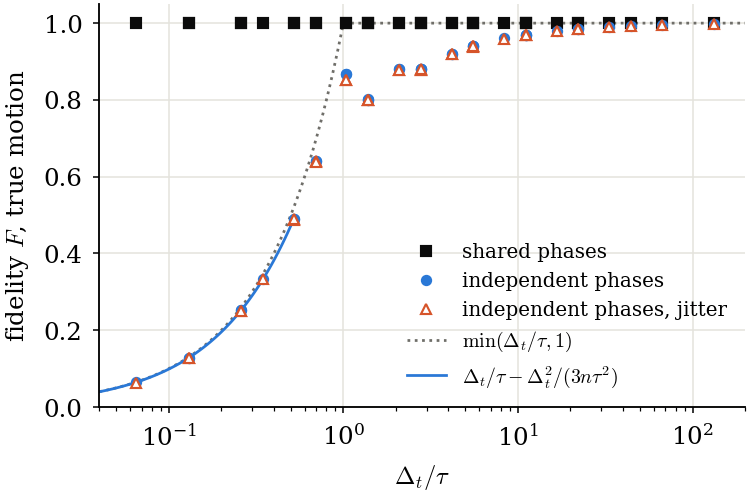
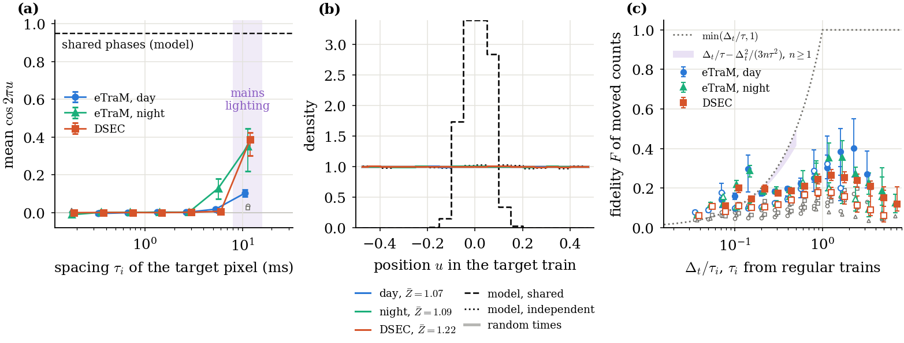
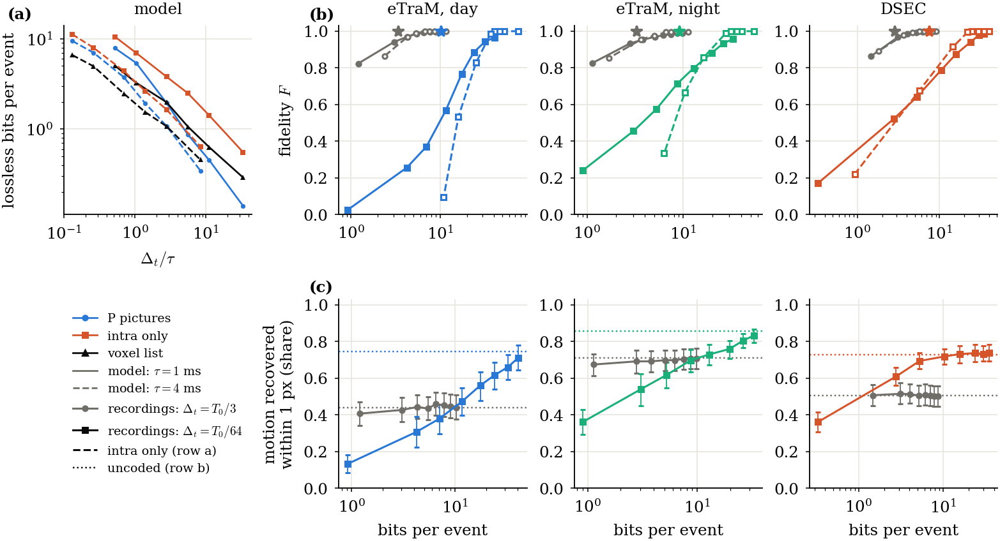

```
directive: 028
status: DONE
executed_commit: bac131d (results/pc2), 929e8be (figures drawn from the committed results/pc2)
results: results/pc2/binned_fidelity.json, results/pc2/motion_task.json, results/pc2/checks.json, results/pc2/provenance.json,
         results/paper/fig_control.{pdf,png,json}, results/paper/fig_recordings.{pdf,png,json}, results/paper/fig_coding.{pdf,png,json}
```

## What ran

1. **Files (D-028-1).** Appendices A and B were written to `scripts/fig_028.py` and `tests/test_fig_028_gate.py`,
   each as the text between the fence lines plus one newline (commit `042766b`). Both SHA-256 match Section 10.
2. **Section 4 (D-028-2).** `scripts/pc2_build.py` read the kept per-group outputs of directives 022 and 019
   on `cnt`:
   - 136 `ph` outputs and 385 `hd` outputs (D1 and D2 tasks; D3 was not read);
   - the committed `results/ph/report.json` and `results/hd/frontier.json`.
   
   It took 21 s of CPU. No recording was opened, and nothing was recomputed, so no projection was due.
   `scripts/pc2_provenance.py` wrote `results/pc2/provenance.json`.
3. **Host checkout.** The suite's gate and the builder read committed results. `scripts/sync_cnt.sh` never
   sends `results/`, so the committed `results/{paper,td2,hd,hc,pc}` and `results/ph` were copied into the
   checkout on `cnt` before the suite and the builder ran there, as in directive 027.
4. **Two choices made while building, both in the definitions below:**
   - the rows of `grids` are the bins of `r` with a finite centre, and the no-tau and `[128, inf)` bins are
     kept under `other_bins`;
   - the motion-task reference uses the same D1 squares as the QP points, with the all-groups value kept.
   
   The first build (at `042766b`) still counted the no-tau bin in `share_events_in_plotted_bins` (0.99 by
   day). It was corrected before anything was committed under `results/`.
5. **Definitions before plots.** The Definitions below were written and committed with `results/pc2/`
   (`929e8be`) before any figure was drawn.
6. **Figures (Section 5)** on the laptop (matplotlib 3.10.9), from committed files:

   ```
   python3 scripts/fig_028.py --pc results/pc --pc2 results/pc2 --hc results/hc --paper results/paper --out results/paper
   ```
7. **Suite** on `cnt` at `bac131d`, the last code commit: 180 tests, 0 failures, 0 errors, 0 skipped (from
   `--junitxml`). It was also run at `042766b`, with the same result.

## Definitions

These definitions were written from the code before any figure of Section 5 was drawn, and committed with
`results/pc2/` at `929e8be`. The code is `scripts/pc2_build.py` at `bac131d`, which reads the kept
per-group outputs of directive 022 (`ec.phase.evaluate_group`) and directive 019 (`hd_run`). No recording was
opened: the outputs of 022 and 019 were still on the hosts, so no recomputation was needed and no cost
projection was due.

### A. Binned fidelity of moved counts (`results/pc2/binned_fidelity.json`)

1. **The span of `tau_reg`.**
   - The span is the events of `[(w - 3) T0, (w + 1) T0)`: windows `w - 3` to `w`, about 133 ms, after the
     hot-pixel rule. The scored window `w + 1` is excluded.
   - `tau_reg` of a pixel-polarity is the median of its regular intervals in that span. Two consecutive
     intervals `a`, `b` of one pixel-polarity form a regular pair when `max(a, b) <= 1.2 min(a, b)`,
     `min > 0` and `a + b <= T0`. An interval is regular when it is in such a pair.
   - Each pixel-polarity enters the bin of its own `r = dt / tau_reg`, with `dt = T0 / k`.
2. **Which events enter `N`, `N2`, `M` and `M0`.** Only the blocks that `evaluate_group` scores enter: the
   20 x 20 blocks with at least `N_MIN = 50` true events in window `w + 1`, whose best shift has at least 25
   pairs (else "no source", skipped), and whose true and moved events in the block both number at least 50.
   - The key set is the union of the pixel-polarities of the true events and the moved events in the block.
   - `N` is the true events of window `w + 1` of each key.
   - `N2` is its moved events: the events of window `w`, moved by the block's shift and its onset delay,
     that land in the block and in window `w + 1`.
   - `M` is the sum, over voxels (1 px, `T0 / k`, polarity), of `min(true, moved)`.
   - `M0` is the same with the moved times redrawn uniformly in the window (the null).
   - A key with true events and no moved event enters with `N2 = 0` and `M = 0`. A key with moved events and
     no true event enters with `N = 0` and `M = 0`. Both lower `F`.
   - A key without `tau_reg` goes to the "no tau" bin. A key with a flicker spacing (10 ms or 8.33 ms, within
     2%) goes to the `flicker = 1` slice. Rows use `flicker = 0`, with all three speed classes (0 to 1, 2 to
     5, at least 6 px per window) pooled, as Table 2 of report 022.
3. **The motion of the prediction.** It is estimated, causal, and per block:
   - every integer shift with |dx|, |dy| <= 32 is scored on the pair (`w - 1`, `w`) by the pairs of
     directive 020;
   - among the shifts within `2 sqrt(m)` of the most pairs `m`, the smallest `|dx| + |dy|` wins;
   - the onset delay is the median, over the block's pixel-polarities, of the first true event minus the
     first moved event in window `w`, clipped to `T0 / 2`;
   - the prediction moves window `w` onto `w + 1`.
   
   It is not the exact motion that Eq. (binfidmoved) assumes. Blocks with shift (0, 0) are included: they are
   in speed class 0 to 1, which is pooled.
4. **Statistics.**
   - `F = 2 M / (N + N2)` and `F0 = 2 M0 / (N + N2)` are summed over all groups and recordings of the stratum.
     They are event-weighted, and a recording with many events weighs more.
   - `F_ci95` resamples all recordings of the stratum (also those with `N = 0` in the bin) 2,000 times, seed
     20261016, and recomputes the pooled F.
   - `n_recordings` counts the recordings with `N > 0` in the bin.
   - The rows of `grids` are the bins of `r` with a finite centre (bins 0 to 28 of `ec.threshold.R_EDGES`).
     The bin `[128, inf)` and the no-tau bin have no `r` to plot at; they are under `other_bins`.
   - Each row adds `F_k1_same_pixels`: F on the grid (1, 1) for the same pixel-polarities. The edges step by
     sqrt(2), so the pixel-polarities of bin `b` at `T0 / 32` are those of bin `b + 10` at `T0 / 1` (`b + 12`
     from `T0 / 64`); this is exact for bins 1 to 18 at k32. At (1, 1) a voxel is the whole window, so
     `M = sum over keys of min(true count, moved count)`. This is count matching with no timing at all, and an
     upper bound of `F` on any finer grid.
5. **Coverage denominator.** Both shares are of `N` over all flicker classes, speed classes and bins, the
   no-tau bin included, on (1, 32): the true events of window `w + 1` in the keys of the blocks that entered.
   - This is the denominator of Table 4 of report 022.
   - It is not all events of the window: candidate blocks with fewer than 50 events, skipped blocks and blocks
     with too few moved events are outside it.
   - `share_events_with_tau_reg` = 1 minus the no-tau share. `share_events_in_plotted_bins` is the `N`
     (flicker 0) of the rows that pass the rule of `fig_028.py` (`N >= 10,000`, `n_recordings >= 5`).
6. **The distance between `F` and the equation, by range of `r`.** These are pooled values on (1, 32);
   `F_k1` is the count bound of item 4.

   - **`r < 1/4`: Eq. (binfidmoved) applies.** In all three strata, at `r` = 0.074 and 0.105, F (0.11 to 0.22) lies
     above `r - r^2 / 9` (0.074, 0.104). Near `r = 1/8` it is close to the equation for DSEC (0.146 at
     r = 0.149, against 0.146). By day and night there is a bump at `r = 0.149` (F = 0.298 and 0.289). It comes
     from the blocks of speed class 0 to 1 (|shift| <= 1 px), whose F there is 0.50 by day and 0.35 at night
     (Table 3 of report 022). A shift of 0 or 1 px maps a pixel onto itself or its neighbour, so a timing that
     persists in one pixel survives the prediction. That is not the independent-phase case of the equation.
     The fast blocks (at least 6 px per window) give 0.11 to 0.21 here. **The data do not attribute why F
     exceeds the equation at the smallest `r`.**
   - **`1/4 <= r <= 1/2`: the equation applies, and F lies below it.** At `r` = 0.297 and 0.420 the equation
     gives 0.287 and 0.401. F is 0.17 to 0.20 in all strata. `F_k1` is 0.64 to 0.67 there, so count matching
     alone already caps F near two thirds of the moved and true events. The rest of the gap is timing under the
     estimated motion: the shift and delay errors and short trains. **The sums cannot separate these two.**
   - **`r > 1/2`: the equation does not apply** (NaN in `ec.threshold.predicted`).
     - `min(r, 1)` would reach 1 for `r >= 1`, where `dt >= tau`. F stays at 0.22 to 0.40 by day, 0.13 to 0.36
       at night and 0.08 to 0.27 on DSEC, and falls again at the largest `r`.
     - Two causes follow from the definitions. First, count mismatch: `F_k1` is 0.64 to 0.72 by day, 0.48 to
       0.67 at night and 0.69 to 0.74 on DSEC. `N2 / N` falls below 1 at night from `r = 0.6` (0.91, down to 0.30 at
       `r = 9.5`) and on DSEC from `r = 3.4` (0.98, down to 0.21 at `r = 9.5`); there the moved trains hold fewer
       events than the true ones. By day it stays between 0.96 and 1.14. Second, the
       timing of whole short trains: at large `r` the spacing is below `dt`, so a train of a few events falls in
       one or two voxels, and a delay error of more than `dt` misses all of it.
     - The rise toward `r ~ 2` by day and night again comes from the blocks of speed class 0 to 1 (F 0.64 to
       0.77 by day). The fast blocks stay at 0.21 to 0.26 by day and 0.23 to 0.25 at night from `r = 0.6` to 3.4.
     - So on moving content the fidelity of moved counts is nearly flat in `r`. It is limited by count matching
       and by the estimated motion, not by `dt / tau`. **The sums cannot attribute the share of each.**

### B. Motion task (`results/pc2/motion_task.json`)

1. **Records.** The records come from `ec.families._Tasks.run`, key `motion`, placement `start`.
   - Per group of directive 019, the squares are `fb_run.squares_for` on the true events of window `w + 2`:
     the 10 densest 40 x 40 squares with at least 200 events.
   - The velocity is `ec.downstream.cmax_velocity` (contrast maximisation) over the square, warped to
     `(w + 2) T0`. `error_px = |v_dec - v_true| T0`, in px per window.
2. **Operating points.**
   - **QP points:** the P-picture modes `qp12` to `qp28` of the D1 groups of 019 (`j % 40 == 0` eTraM,
     `j % 20 == 0` DSEC), for recordings with at least 2 (eTraM) or 1 (DSEC) groups, as `hd_reduce`.
   - **Reference:** the uncoded representation (`hevcdiag.represent`, counts on (1, k) back to events at the
     voxel start) on **the same D1 groups and squares**. The directive names D2 as the reference without saying
     on which groups. The same squares make the line comparable with the points.
   - `reference_all_019_groups` gives it on every group of 019 (D1 and D2 tasks: the population of Table 2 of
     report 019). It differs by at most 0.025.
3. **Undefined squares.** A square is undefined when the true velocity is not finite. `cmax_velocity` returns
   NaN only for an empty set, and every square holds at least 200 true events of that window, so no square is
   undefined: `n_undefined = 0` everywhere. A record with a NaN error and `n_rec > 0` would have been counted
   as undefined; none occurred.
4. **Failures.** A failure is a defined square whose decode leaves no event in it (`n_rec == 0`). Its decoded
   velocity is then NaN, and it counts as not recovered.
5. **Statistics.**
   - `success1` is the share of defined squares with error <= 1 px per window, pooled over the squares of
     the stratum, with a bootstrap over recordings (2,000 resamples, seed 20261016).
   - `fail_share` is the share of defined squares that fail.
   - `median_err` is the pooled median with failures counted as infinite, or null if `fail_share >= 0.5`.
   - `b` is the median over recordings of bits per true event of the four windows at that QP, equal to
     `results/hd/frontier.json` (checked to 1e-9).
6. **The earlier statistic.** `success_only_median_err` reproduces `motion_error_px` of
   `results/hd/frontier.json` (to 1e-9 at all 48 operating points). It is the median over recordings of the
   per-recording median of the **finite** errors. A failed square drops out of it.
7. **Population against the F panels.** The F panels (directive 021) use the same D1 groups. They score F
   over the four windows, per recording and pooled over its groups, with the x265 runs of 021. The task scores
   10 squares per group in window `w + 2` only, with the x265 runs of 019, and its `b` is that of 019.
8. **Squares per stratum and grid** (each operating point): 502 by day (42 recordings), 635 at night (34) and
   770 on DSEC (36), on both (1, 3) and (1, 64).

## fig_control (Fig. 3)



**What it plots.** One panel, from `results/pc/report.json#/control` (directive 027).
- Points: F of the counts moved along the true motion against `dt / tau`, for three conditions (shared phases,
  independent phases, independent phases with jitter of 0.05 tau).
- Lines: `min(dt / tau, 1)`, and Eq. (binfidmoved) for n = 3 where `dt <= tau / 2`.

**Statistics.**
- F is `2 M / (N + N2)` on one-pixel voxels of `T0 / k`, over the 12 windows of one synthetic scene per cell:
  320 x 240 pixels, 6 px per window, n = 3 events per pixel and passage, spacing 40, seed 1.
- The motion is exact (`hevcdiag.oracle_shift`). The three conditions share edges, arrival times and counts.
- There is one scene per cell, so there is no interval and no failure or empty cell.

**Numbers.**
- Shared phases: F = 1.000 in all 36 cells (6 tau x 6 k).
- Independent phases, where the equation applies (`dt / tau <= 1/2`, 6 cells): within 0.0004 of the
  equation, e.g. 0.2526 against 0.2529 at `dt / tau = 0.26`.
- Independent phases for `dt / tau >= 1`:
  - about 0.87 at 1.04, 0.80 at 1.39, 0.88 at 2.1 to 2.8 and 0.92 at 4.2;
  - at least 0.97 from 11.
- Jitter changes F by at most 0.016.

**Supported**, on this model (straight edges, n = 3, exact motion, counts equal by construction):
- With the motion exact and the counts equal, independent phases alone reduce F to Eq. (binfidmoved) for
  `dt / tau <= 1/2`. Shared phases give F = 1. The phase is therefore sufficient to cause the loss in this
  model.
- Jitter of 0.05 tau adds little to that loss.

**Not supported.**
- That the loss on recordings has this cause. The model has exact motion, matched counts and regular trains,
  and recordings have none of these (see fig_recordings).
- That F follows `min(dt / tau, 1)` above `dt / tau = 1/2`. In the model it is 0.80 to 0.92 between 1 and 4,
  below that line.
- Anything about n other than 3, or about curved edges or varying speed.

## fig_recordings (Fig. 4)



**What it plots.**
- **(a)** The phase lock, mean `cos 2 pi u`, against the spacing `tau_i` of the target pixel, per stratum,
  with 95% intervals. The values come from `results/paper/fig_phase2.json`, which is directive 022 Table 1
  (`moving_by_tau_bin`, bins with at least 1,000 pixels). The model level with shared phases and the band of
  mains lighting are marked.
- **(b)** The histogram of `u`, centred on 0, per stratum, with random times and the two model kinds, from
  `results/pc/report.json`. The legend gives the mean per-block Rayleigh statistic.
- **(c)** F of moved counts against `dt / tau_reg` on (1, 32) (filled) and (1, 64) (open), with 95% intervals
  and `F0` (null) in grey, from `results/pc2/binned_fidelity.json`. It also shows the band of Eq.
  (binfidmoved) for n = 1 to infinity, and `min(r, 1)`.

**Statistics.**
- **(a)** The mean of `cos 2 pi u` over moving pixels (flicker excluded, speeds pooled), each target
  pixel-polarity once. The interval is a bootstrap over recordings of the pooled ratio.
- **(b)** Counts of `u` over the pixels of moving blocks, in the band `TAU_LO <= tau_i < TAU_HI` and outside
  flicker. Z is computed per block with at least 5 such pixels, as defined in directive 027.
- **(c)** The definitions under "Definitions, A": event-weighted pooled F; bins with `N >= 10,000` and at
  least 5 recordings; estimated causal motion. Empty bins and the no-tau bin are not plotted.

**Numbers.**
- **(a)** For `tau_i` from 0.18 to 2.8 ms, mean cos lies within ±0.012 of 0 in every stratum, with intervals
  that include 0 or nearly so. It rises in the 4 to 8 ms bin at night (0.128 [0.074, 0.178]). It rises most
  in the 8 to 16 ms bin, the band of mains lighting: 0.103 by day, 0.352 at night and 0.386 on DSEC. The model
  with shared phases is near 0.95.
- **(b)** Mean Z of `pred`:

  | stratum | mean Z | 95% interval | blocks |
  |---|---|---|---|
  | day | 1.067 | [1.021, 1.132] | 15,028 |
  | night | 1.094 | [1.057, 1.135] | 6,933 |
  | DSEC | 1.216 | [1.037, 1.462] | 44,715 |

  The null is 0.997 to 1.007. The model gives 63.8 with shared phases and 1.045 with independent ones.
- **(c)**
  - Coverage, of the true events of window `w + 1` in the scored blocks:

    | stratum | events with `tau_reg` | events in the plotted bins at (1, 32) |
    |---|---|---|
    | day | 33.9% | 33.3% |
    | night | 32.8% | 28.3% |
    | DSEC | 48.2% | 43.5% |

  - F at (1, 32) over the plotted bins: 0.14 to 0.40 by day, 0.12 to 0.36 at night, 0.08 to 0.27 on DSEC.
    It always lies above `F0` (0.06 to 0.20).
  - `F_k1`, the count-matching bound of the same pixels, is 0.48 to 0.75.

**Supported.**
- **On the selected trains** (moving blocks, regular trains, spacing in the band, outside mains flicker),
  there is no detectable lock of the moved events to the timing of the target pixel within blocks. The mean Z
  is 1.07 to 1.22 with intervals below 2, while the same test gives 64 on a model with a lock. This holds for
  `tau_i` below about 3 ms, in all three strata, on the pixels and blocks that Table 2 of report 027 states
  (the test covers 27% to 33% of the true events of the scored windows, and 19% to 29% within the band).
- A lock appears at spacings of 8 to 16 ms, the mains band, and at night already at 4 to 8 ms. It is the
  persistence of lighting flicker, not a phase shared along a moving edge.
- On recordings, the fidelity of moved counts at (1, 32) is 0.1 to 0.4, above the null, and well below the
  count-matching bound. For moving blocks it is nearly flat in `r` (see Definitions A.6).

**Not supported.**
- That the phases on recordings are uniform or independent. A flat histogram and a mean Z near 1 show no
  detectable lock on the selected trains at the tested scale, nothing more. The `pred` intervals lie slightly
  above 1 and above the null in all strata. A weak lock, a lock outside the band, or a lock on the 67% to 73%
  of events that the test does not cover is not excluded.
- That panel (c) tests Eq. (binfidmoved) on recordings. The motion is estimated and causal, the counts do not
  match (`F_k1` 0.48 to 0.75), and zero-shift blocks are pooled in. So (c) does not show the equation holding
  or failing on recordings.
  - The agreement near `r = 1/8` is partly due to slow blocks (|shift| <= 1 px).
  - The distance for `r >= 1/4` comes from count mismatch and estimated motion. Their shares cannot be
    separated from the sums.
- That the plotted F describes all events. It describes 28% to 44% of the true events of the scored blocks,
  and fewer of the window.

## fig_coding (Fig. 6)



**What it plots.**
- **(a)** The model of directive 021: lossless bits per event against `dt / tau` for n = 3, tau = 1 ms
  (solid) and 4 ms (dashed), for P pictures, intra pictures only and the voxel list. Source:
  `results/hc/report.json#/tables/5_model`.
- **(b)** Per stratum, F against bits per event, from `results/hc/report.json#/tables/1_prediction_lossless`
  and `2_prediction_lossy` (directive 021):
  - P pictures (solid) and intra only (dashed);
  - on (1, 3) in grey and (1, 64) in the stratum colour;
  - the voxel list at F = 1 (star).
- **(c)** Per stratum, the share of squares whose motion the P-picture decode recovers within 1 px per window,
  failures counted as not recovered, against bits per event. It has 95% intervals, and the uncoded
  representation on the same squares as a dotted line. Source: `results/pc2/motion_task.json`.

**Statistics.**
- **(a)** Bits per event of one synthetic scene per cell.
- **(b)** Medians over recordings of the per-recording pooled F and bits (directive 021, D1 groups).
- **(c)** The definitions under "Definitions, B":
  - squares from the 019 D1 groups, pooled over the stratum;
  - an interval from a bootstrap over recordings;
  - a failure counts as a miss;
  - no square is undefined.

**Numbers.**
- **(a)** At tau = 1 ms the P pictures cost fewer bits than the voxel list from `dt / tau` of about 2.8
  (1.95 against 1.99), and 0.14 against 0.29 at 33. At tau = 4 ms they cost more up to 5.6 (1.93 against
  1.55), the same at 11 (1.08), and fewer at 33 (0.35 against 0.46). Intra only always costs the most.
- **(b)** On (1, 64), P pictures reach F of 0.965 (day), 0.956 (night) and 0.987 (DSEC) at 41, 33 and 35 bits
  per event. The voxel list gives F = 1 at 10.2, 9.1 and 7.5 bits. Near the voxel list's bits, P pictures give
  about 0.57 (day, 11.6 b), 0.72 (night, 8.7 b) and 0.79 (DSEC, 10.4 b). On (1, 3) the voxel list costs 3.4,
  3.3 and 2.8 bits, and P pictures there give 0.94 (day, 3.1 b), 0.93 (night, 2.8 b) and 0.97 (DSEC, 3.1 b).
- **(c)** Motion recovered within 1 px, with the success-only median of `results/hd/frontier.json`:

  | stratum | grid | QP | bits | success1 [95%] | fail_share | median_err (failures infinite) | success-only median |
  |---|---|---|---|---|---|---|---|
  | day | (1, 64) | 12 | 40.8 | 0.711 [0.645, 0.779] | 0.000 | 0.667 | 0.667 |
  | day | (1, 64) | 20 | 11.6 | 0.472 [0.395, 0.548] | 0.131 | 1.333 | 0.943 |
  | day | (1, 64) | 24 | 4.2 | 0.307 [0.224, 0.388] | 0.285 | 3.399 | 1.412 |
  | day | (1, 64) | 28 | 0.9 | 0.131 [0.083, 0.181] | 0.492 | 33.2 | 5.994 |
  | night | (1, 64) | 12 | 32.7 | 0.831 [0.795, 0.865] | 0.000 | 0.000 | 0.000 |
  | night | (1, 64) | 28 | 0.9 | 0.361 [0.292, 0.427] | 0.326 | 2.749 | 0.943 |
  | DSEC | (1, 64) | 12 | 35.0 | 0.739 [0.693, 0.783] | 0.000 | 0.667 | 0.667 |
  | DSEC | (1, 64) | 28 | 0.33 | 0.361 [0.307, 0.415] | 0.084 | 1.886 | 1.589 |
  | day | (1, 3) | 12 to 28 | 10.2 to 1.2 | 0.406 to 0.458 | 0 to 0.004 | 1.33 to 1.49 | 1.37 to 1.49 |
  | night | (1, 3) | 12 to 28 | 9.8 to 1.1 | 0.674 to 0.707 | 0 to 0.003 | 0.667 | 0.667 |
  | DSEC | (1, 3) | 12 to 28 | 8.6 to 1.5 | 0.500 to 0.514 | 0 | 0.94 to 1.14 | 0.94 to 1.04 |

  The uncoded reference on the same squares:

  | stratum | (1, 3) | (1, 64) |
  |---|---|---|
  | day | 0.438 | 0.745 |
  | night | 0.712 | 0.855 |
  | DSEC | 0.504 | 0.727 |

  All 48 operating points are in `results/pc2/motion_task.json`.

**Supported.**
- **(a)** On the model, P pictures beat the voxel list in lossless bits only when `dt / tau` is large (from
  about 3 at tau = 1 ms, from about 11 to 33 at tau = 4 ms). This holds for n = 3 at 6 px per window.
- **(b)** On recordings, x265 P pictures need several times the bits of the voxel list to reach F near 1 on
  (1, 64). At the voxel list's bits they give F of about 0.6 to 0.8. This holds per stratum, for medians over
  the recordings of the D1 groups, and for these QPs. On (1, 3) the gap is smaller.
- **(c)** On (1, 64), the share of squares whose motion is recovered falls with the bits:
  - by day, from 0.71 at 41 bits to 0.13 at 0.9 bits;
  - at night, from 0.83 to 0.36;
  - on DSEC, from 0.74 to 0.36.
  
  Failures (no decoded event in the square) reach 49% by day at QP 28. On (1, 3) the share hardly depends on
  the QP, and equals the uncoded representation within the intervals. There the time grid, not the coding,
  limits the task.
- **The success-only statistic understates the loss.** At QP 24 by day it gives 1.41 px. The squares counted
  with their failures give 3.40 px, and 31% are within 1 px.

**Not supported.**
- That the motion task measures F. It scores 10 dense squares per group in window `w + 2`, with the x265 runs
  and bits of directive 019. The F panels score all events of four windows, with the runs of 021. The groups
  are the same, but the bits are not paired point by point.
- That the uncoded representation is an upper bound of the coded points. On (1, 3) by day some QPs lie above
  it (0.458 against 0.438), within the intervals.
- That the model of panel (a) predicts the recorded bits of panel (b). Panel (a) is lossless on a synthetic
  scene; (b) is lossy on recordings.
- Anything about other coders, GOP structures or tune settings than those of directives 019 and 021.

## Acceptance checks

| # | check | outcome |
|---|---|---|
| 1 | SHA-256 of Section 10; suite passes with no skipped test | **PASS**. `scripts/fig_028.py` `11c30255...5f28324`, `tests/test_fig_028_gate.py` `73ffa215...91e3edf8`. Suite at `bac131d` on `cnt`: 180 tests, 0 failures, 0 errors, 0 skipped. The committed `results/{paper,td2,hd,hc,pc}` and `results/ph` were copied into the host checkout first |
| 2 | `F` at (1, 32) equals `F_pooled` of report 022 Table 2 `reg` to 1e-9; `1 - share_events_with_tau_reg` equals `share_true_events_without_tau_reg` to 1e-6 | **PASS**. Largest deviation 0.0 over 18 (day), 19 (night) and 20 (DSEC) finite bins, the `other_bins` included. The coverage deviation is 0.0 in all strata, with the same denominator (stated in Definitions A.5) |
| 3 | median of the finite errors equals `motion_error_px` of `frontier.json` to 1e-9; `success1 + fail_share <= 1` | **PASS** at all 48 operating points (3 strata x 2 grids x 8 QPs). `motion_error_px` is a median over recordings of per-recording medians, so the comparison uses that construction (`success_only_median_err`). `b` also equals the frontier to 1e-9 |
| 4 | three figures as PDF, PNG and JSON; `fig_recordings.json` `c.<stratum>.coverage` equals `binned_fidelity.json` | **PASS**. All 9 files exist, and the coverage objects are equal for day, night and DSEC |
| 5 | no eTraM val or test file opened, annotation root not listed; under `results/` only `results/pc2/` and the three figures | **PASS**. No recording or annotation was opened (`results/pc2/provenance.json#/files_read`), and no directory was listed. Under `results/`, the commits add only `results/pc2/` (4 files) and the 9 figure files |
