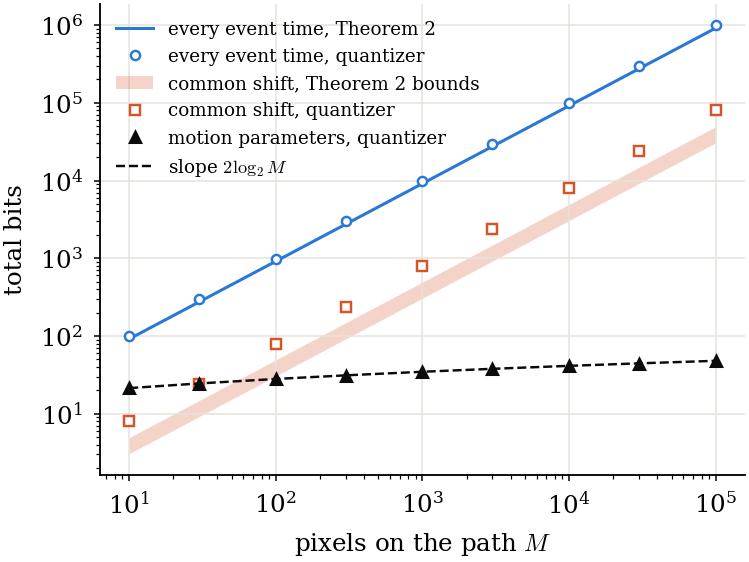
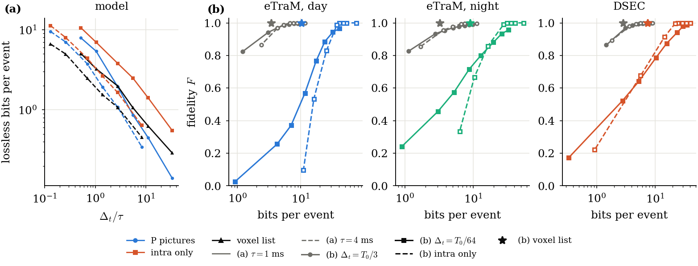
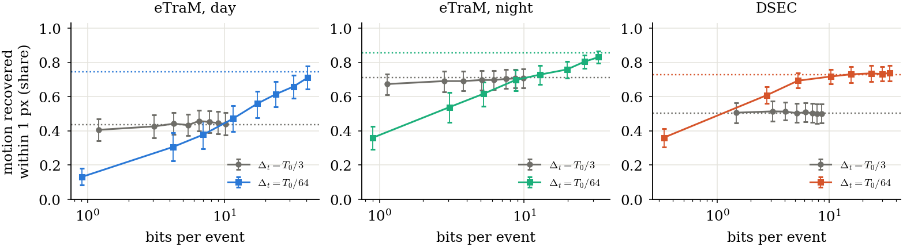

```
directive: 029
status: DONE
executed_commit: ab1aa23 (run), 6dfa977 (figures drawn from the committed results/st)
results: results/st/report.json, results/st/provenance.json,
         results/paper/fig_scaling.{pdf,png,json}, results/paper/fig_phase4.{pdf,png,json},
         results/paper/fig_coding_cost.{pdf,png,json}, results/paper/fig_task.{pdf,png,json}
```

## What ran

1. **Files (D-029-1).** Appendices A to C were written to `ec/structure.py`, `tests/test_structure_gate.py`
   and `scripts/fig_029.py`, each as the text between the fence lines plus one newline (commit `ab1aa23`).
   All three SHA-256 match Section 7.
2. **Runner (D-029-2).** `scripts/st_run.py` writes `results/st/report.json` as
   `{"directive": "029", "paths": path_costs(), "power": power_table()}`. It converts NumPy values to JSON,
   non-finite floats to null (none occurred). It also writes `results/st/provenance.json`.
   - It ran on `cnt` at `ab1aa23` under `nice -n 19` with one BLAS thread: `path_costs` 5 s, `power_table`
     273 s of CPU.
   - It ran twice: the second time to record the suite line in the provenance. The two `report.json` were
     byte-identical.
3. **Suite** on `cnt` at `ab1aa23`: 185 tests, 0 failures, 0 errors, 0 skipped (from `--junitxml`). Before it
   ran, the committed `results/{pc,pc2,hc,paper}` (with `td2` and `hd`) were copied into the host checkout,
   since `scripts/sync_cnt.sh` never sends `results/`.
4. **Figures (Section 4)** on the laptop (matplotlib 3.10.9), from committed files:

   ```
   python3 scripts/fig_029.py --st results/st --pc results/pc --pc2 results/pc2 --hc results/hc --paper results/paper --out results/paper
   ```
   
   In `fig_phase4` the x label of panel (c) is cut at the right edge ("lock width w (0: shared, 1:
   independen..."). This comes from the layout of the script of Appendix C, which is left unchanged.

## 1. Definitions (from `ec/structure.py`)

**The path model.**
- One straight edge translates along a row of M pixels. Pixel i starts its passage at `t_i = (i - x0) / v`.
- It emits n = 3 events at `t_i + A_i + (k - 1) tau + eps`, with `A_i` uniform on (0, tau] and `eps` normal
  with sigma = 50 us.
- `tau = W_PX / (n v)` with a ramp of 3 px. The fine and common-shift curves use v = 1 px/ms, so tau = 1 ms.
  Then `D_A = sigma^2 + tau^2 / 12 = 85,833 us^2`.

**The three descriptions and their tolerances** (mean squared error per event time):

1. **Every event time**, at `D_FINE = sigma^2 / 16 = 156.25 us^2`.
   - **Theory:** M times `R_fine = h - (n / 2) ln(2 pi e D_FINE)` (Eq. (rdlow); `h` with the entropy of a
     uniform on (0, sqrt(n) tau) plus N(0, sigma^2)). It is 6.337 nats = 9.142 bits per pixel.
   - **Quantizer:** the n times of a pixel, less their known part, are rotated by an orthonormal matrix
     whose first column is `1 / sqrt(n)` (Eq. (XW)): column 0 is the common shift, and the others are the
     n - 1 relative components.
   - One uniform quantizer of the same step covers all three columns. Each cell reconstructs at the mean of
     its members.
   - The bits are the sum over columns of the empirical entropy of the indices, so the columns are coded
     separately and not jointly.
2. **The common shift only**, at `D_MID = (sigma^2 + D_A) / 2 = 44,167 us^2`.
   - **Theory:** the bounds of Eq. (rdmid), times M. The upper bound is
     `1/2 ln(s^2 / (n D_MID - (n - 1) sigma^2))` with `s^2 = n tau^2 / 12 + sigma^2`, and the lower bound is
     that minus `Gamma`: 0.306 to 0.493 bits per pixel.
   - **Quantizer:** a uniform quantizer on column 0. The relative components are reconstructed at 0. The bits
     are the empirical entropy of the indices.
3. **The motion parameters**, at `(1 + XI) D_A` with `XI = 0.1`, for a receiver that holds the template.
   - **Bits:** `x0` (uniform on (0, M)) and `v` (uniform on 0.5 to 2 px/ms) each get a uniform quantizer.
     The bits are `log2(ceil(M / dx)) + log2(ceil((V_HI - V_LO) / dv))`: a fixed-length code of the cell
     indices, without entropy coding.
   - **Steps:** each parameter may bias every regenerated mean time by at most `b = sqrt(XI D_A,min) / 2`,
     with `D_A,min` at the fastest speed (tau = 0.5 ms).
     - `dx = V_LO b`, since |dt / dx0| = 1 / v <= 1 / V_LO.
     - `dv = b V_LO^2 / (M + W_PX)`, since |d tbar / dv| <= (M + W_PX) / V_LO^2.
     
     So `dv` shrinks as 1 / M, and the bits grow as 2 log2 M.
   - **Distortion:** measured on 200 simulated paths per M. Each path has a random (x0, v), and the cells
     reconstruct at their centre. The regenerated times are `(i - x0_hat) / v_hat + (k - 1/2) tau(v_hat)`
     (Eq. (regen)), each event at the mean of its uniform phase. The distortion is the mean squared error
     over all events of the path, divided by `D_A` of the path's true v. `D_over_DA_mean` averages it over
     paths, since Proposition 1 bounds an expected distortion; `D_over_DA_max` is the worst path.

**How the quantizer steps are chosen.** For the per-pixel quantizers, the step is the largest that keeps the
measured distortion at or below the target. It is found by 40 geometric bisections between `1e-3 sigma` and
`100 tau`, measured on 200,000 simulated pixels, seed 1.
- Every event time: step 44.19 us, D = 156.2496 us^2, at most the target 156.25.
- Common shift: step 1,393 us, D = 44,166.5 us^2, at most the target 44,166.7.

The per-pixel costs do not depend on M (Theorem 1), so their totals are M times the per-pixel value.

**The lock width and the spacing spread** (`lock_scene`).
- The edges are as in `ec.phase.edge_scene_v`: 320 x 240 pixels, edges 40 px apart, 8 windows, n = 3,
  tau = 2 ms, jitter `0.05 tau_i`.
- The phase is `A_i = tau_i (1 - frac(a + w (U_i - 1/2)))`. Here `a` is uniform, one per row and edge, and
  `U_i` is uniform per pixel. So w = 0 is one shared phase per path, and w = 1 gives independent phases.
- The spacing varies per pixel: `tau_i = tau exp(cv Z_i)`, with `Z_i` standard normal and cv in (0, 0.2).
- The edges and arrival times do not depend on w.

**The test and its pooling** (`power_table`). For each (cv, w), 9 scenes (speeds 2.5, 6.5 and 13.3 px per
window, seeds 1 to 3) are each scored by `ec.phase_control.block_phases(ev, 5, 320, 240)`.
- This is the test of directive 027, with the shift and onset delay estimated from the events as on
  recordings.
- The scenes are pooled with `ec.phase_control.pool`, each as one "recording".
- The mean Z is over blocks with at least 5 tested pixels. The 95% interval is from a bootstrap over the 9
  scenes (2,000 resamples, seed 20261016). The null is the same test with the moved times redrawn uniformly.

## 2. Table 1: costs along a path

Total bits per path. The fine and common-shift columns are at tau = 1 ms. The motion is at v uniform on 0.5
to 2 px/ms.

| M | every event time, Theorem 2 | every event time, quantizer | common shift, lower bound | common shift, upper bound | common shift, quantizer | motion, quantizer | motion D / D_A, mean over 200 paths (max) |
|---|---|---|---|---|---|---|---|
| 10 | 91.4 | 99.1 | 3.1 | 4.9 | 8.0 | 21.4 | 1.0104 (1.929) |
| 30 | 274.3 | 297.2 | 9.2 | 14.8 | 23.9 | 24.3 | 1.0143 (1.543) |
| 100 | 914.3 | 990.7 | 30.6 | 49.3 | 79.7 | 27.7 | 0.9993 (1.223) |
| 300 | 2,742.8 | 2,972.1 | 91.9 | 147.9 | 239.2 | 30.8 | 1.0007 (1.153) |
| 1,000 | 9,142.5 | 9,907.0 | 306.3 | 492.9 | 797.3 | 34.3 | 1.0022 (1.084) |
| 3,000 | 27,427.6 | 29,721.1 | 919.0 | 1,478.7 | 2,392.0 | 37.4 | 1.0003 (1.052) |
| 10,000 | 91,425.4 | 99,070.4 | 3,063.3 | 4,928.9 | 7,973.5 | 40.9 | 0.9998 (1.023) |
| 30,000 | 274,276.3 | 297,211.3 | 9,190.0 | 14,786.8 | 23,920.4 | 44.1 | 1.0000 (1.015) |
| 100,000 | 914,254.5 | 990,704.3 | 30,633.2 | 49,289.3 | 79,734.7 | 47.5 | 1.0002 (1.009) |

- **Per pixel, every event time:** the quantizer costs 9.907 bits against 9.142 from Theorem 2, which is 0.765
  bit more per pixel, or 0.255 bit per component.
- **Per pixel, common shift:** the quantizer costs 0.797 bit against the bounds 0.306 to 0.493.
- **Motion:** it costs 21.4 bits at M = 10 and 47.5 bits at M = 10^5. From 10^2 to 10^4 it grows by 13.25
  bits, against `2 log2 100 = 13.29`.
- **Motion distortion:** the mean `D / D_A` is 0.999 to 1.014, within the target of 1.1 at every M. Single
  paths reach 1.93 at M = 10, falling to 1.009 at M = 10^5.

## 3. Table 2: power of the phase test

| spacing spread cv | lock width w | mean Z | 95% interval | blocks | pixels per block | null mean Z |
|---|---|---|---|---|---|---|
| 0 | 0 | 80.516 | [54.541, 104.421] | 828 | 86.2 | 0.961 |
| 0 | 0.1 | 75.359 | [51.162, 97.806] | 828 | 86.2 | 0.997 |
| 0 | 0.2 | 61.791 | [42.129, 80.180] | 828 | 86.2 | 1.016 |
| 0 | 0.3 | 44.114 | [30.314, 57.188] | 828 | 86.2 | 1.030 |
| 0 | 0.4 | 27.081 | [18.819, 35.050] | 828 | 86.2 | 0.973 |
| 0 | 0.5 | 14.083 | [9.941, 18.115] | 828 | 86.2 | 0.922 |
| 0 | 0.6 | 6.174 | [4.506, 7.794] | 828 | 86.2 | 0.961 |
| 0 | 0.8 | 1.264 | [1.141, 1.388] | 828 | 86.2 | 1.014 |
| 0 | 1 | 1.048 | [0.985, 1.108] | 828 | 86.2 | 1.030 |
| 0.2 | 0 | 5.059 | [3.952, 6.105] | 828 | 86.1 | 0.984 |
| 0.2 | 0.1 | 4.677 | [3.649, 5.667] | 828 | 86.0 | 1.011 |
| 0.2 | 0.2 | 3.915 | [3.064, 4.746] | 828 | 86.0 | 1.059 |
| 0.2 | 0.3 | 3.011 | [2.393, 3.651] | 828 | 86.0 | 0.996 |
| 0.2 | 0.4 | 2.186 | [1.774, 2.616] | 828 | 86.0 | 1.000 |
| 0.2 | 0.5 | 1.591 | [1.336, 1.869] | 828 | 86.0 | 0.996 |
| 0.2 | 0.6 | 1.229 | [1.079, 1.380] | 828 | 86.0 | 1.060 |
| 0.2 | 0.8 | 1.063 | [0.975, 1.167] | 828 | 86.0 | 1.025 |
| 0.2 | 1 | 1.054 | [0.963, 1.147] | 828 | 86.0 | 0.981 |

## 4. Derived numbers

**The largest lock width the test detects**, meaning the largest w whose 95% interval lies entirely above 2,
the reading threshold of directive 027:

| spacing spread cv | largest detected w | its interval | next grid point |
|---|---|---|---|
| 0 | **0.6** | [4.51, 7.79] | w = 0.8: [1.14, 1.39] |
| 0.2 | **0.3** | [2.39, 3.65] | w = 0.4: [1.77, 2.62] |

**The lock widths the recordings rule out.** Per stratum: the smallest w at which the model's mean Z falls
below the upper end of the stratum's interval (`results/pc/report.json`), by linear interpolation between grid
points. Locks narrower than this w would have given a larger mean Z than the recording.

| stratum | interval of mean Z (027) | w, cv = 0 | w, cv = 0.2 |
|---|---|---|---|
| eTraM, day | [1.021, 1.132] | 0.92 | 0.72 |
| eTraM, night | [1.057, 1.135] | 0.92 | 0.71 |
| DSEC | [1.037, 1.462] | 0.79 | 0.54 |

## 5. Pixels per block

| | pixels | blocks | pixels per block |
|---|---|---|---|
| model, every (cv, w) | 71,169 to 71,382 | 828 | 86.0 to 86.2 |
| eTraM, day | 1,148,835 | 15,028 | 76.4 |
| eTraM, night | 353,733 | 6,933 | 51.0 |
| DSEC | 2,681,912 | 44,715 | 60.0 |

The model's blocks hold more tested pixels than the recordings' blocks: 1.13 times day, 1.69 times night and
1.44 times DSEC. For a lock of given strength, `Z - 1` grows with the pixels per block. So the same lock on
recording-sized blocks gives a smaller mean Z than in Table 2, and the widths of Section 4 are an optimistic
reading for the recordings. **No model was run at the recordings' pixels per block, so the size of that
correction is not measured.**

## 6. Figures

### fig_scaling



**What it plots.** Total bits against M, from `results/st/report.json#/paths/rows`:
- `fine_theory_bits`: line;
- `fine_code_bits`: circles;
- the band from `scalar_lower_bits` to `scalar_upper_bits`;
- `scalar_code_bits`: squares;
- `motion_code_bits`: triangles, with a dashed line of slope `2 log2 M` through its first point.

**Supported**, on this model (one straight translating edge, n = 3, sigma = 50 us, tau = 1 ms for the
per-pixel curves, each description at its own tolerance):
- Describing every event time costs bits in proportion to M, about 9.9 bits per pixel with a simple
  quantizer and 9.1 bits per pixel from Theorem 2.
- Describing the common shift of each pixel also costs bits in proportion to M: 0.8 bit per pixel quantized,
  0.31 to 0.49 bit per pixel from the bounds.
- The two quantized motion parameters cost 2 log2 M plus a constant: 21 to 48 bits from M = 10 to 10^5. Their
  measured mean distortion is within (1 + XI) D_A at every M.
- The motion costs fewer bits than the quantized common shift from M = 100 on (27.7 against 79.7), and fewer
  than the lower bound of the common shift from M = 100 on (27.7 against 30.6).

**Not supported.**
- That the three curves are costs at one tolerance. Each is at its own: `D_FINE`, which is far below
  `D_MID`, which is below `(1 + XI) D_A`. The motion curve is the cheapest because it delivers the coarsest
  times.
- That the motion code is optimal. It is a fixed-length code of uniform cells, sized for the worst speed. An
  entropy code or a better allocation between `x0` and `v` would cost less, and its slope would stay
  2 log2 M.
- That the quantizers meet Theorem 2. They cost 0.77 bit per pixel above it for every event time and 0.30 to
  0.49 bit above the bounds for the common shift.
- Anything about curved paths, varying speed, more than two motion parameters, or recordings.
- That every path stays within the tolerance. The bound is on the mean, and single paths reach 1.93 D_A at
  M = 10.

### fig_phase4


**What it plots.**
- **(a)** The phase lock against the spacing, from `results/paper/fig_phase2.json` (directive 022).
- **(b)** The histogram of u with its controls and the mean Z of the recordings, from
  `results/pc/report.json` (directive 027). Panels (a) and (b) are as in `fig_recordings`.
- **(c)** The mean Z on the model against w, for cv = 0 (filled) and 0.2 (open), with intervals, from
  `results/st/report.json#/power/rows`. The recordings' intervals are shown as horizontal bands, from
  `results/pc/report.json#/strata/<stratum>/rayleigh/pred/mean_Z_ci95`, with the reading threshold 2.

**Supported**, on the model's blocks (86 tested pixels per block, three speeds, tau = 2 ms, estimated motion):
- The test detects a lock of width up to 0.6 of the spacing when the spacings are equal. It detects one up to
  0.3 when they vary by 20% from pixel to pixel.
- With equal spacings, the recordings' mean Z rules out locks narrower than about 0.92 of the spacing by day
  and at night, and 0.79 on DSEC.
- With a spacing spread of 0.2, it rules out locks narrower than 0.72 by day, 0.71 at night and 0.54 on DSEC.
- A spread of 20% in the spacings alone lowers the mean Z of a shared phase from 80.5 to 5.1. The test
  measures u modulo the target pixel's own spacing, and moved events come from pixels with other spacings.

**Not supported.**
- That the recordings have no lock. Locks wider than the widths above, or of any width at a spacing spread
  above 0.2, are not excluded.
- That these widths transfer to the recordings unchanged. The recordings' blocks hold fewer tested pixels
  (51 to 76 against 86), so the same lock would give a smaller Z there (Section 5). The recordings' spacing
  spread is not measured here.
- That the bands of the recordings and the model curves are paired by scene. The model covers three speeds
  at tau = 2 ms. The recordings cover the trains of Table 2 of report 027.

### fig_coding_cost



**What it plots.**
- **(a)** The lossless bits per event of the model of directive 021 against `dt / tau`, from
  `results/hc/report.json#/tables/5_model`.
- **(b) to (d)** F against bits per event per stratum, from `results/hc/report.json#/tables/1_prediction_lossless`
  and `2_prediction_lossy`.

These are rows (a) and (b) of `fig_coding` (directive 028), in one row.

**Supported and not supported:** as stated for `fig_coding` rows (a) and (b) in report 028; the numbers are
the same files.
- **Supported:** on the model, P pictures beat the voxel list in lossless bits only at large `dt / tau`. On
  recordings at (1, 64), x265 P pictures need several times the voxel list's bits to reach F near 1, and give
  F of about 0.6 to 0.8 at the voxel list's bits.
- **Not supported:** other coders or settings, or a prediction of the recorded bits from the model.

### fig_task



**What it plots.** Per stratum, the share of squares whose motion the P-picture decode recovers within 1 px
per window (failures count as not recovered), against bits per event, on (1, 3) and (1, 64). It shows 95%
intervals, and the uncoded representation on the same squares as a dotted line. The source is
`results/pc2/motion_task.json`. This is row (c) of `fig_coding`.

**Supported:**
- On (1, 64) the share falls with the bits: from 0.71 to 0.13 by day, 0.83 to 0.36 at night and 0.74 to 0.36
  on DSEC, as QP goes from 12 to 28.
- On (1, 3) the share hardly depends on the QP and matches the uncoded representation within the intervals.

**Not supported:** the same limits as in report 028.
- The task scores 10 squares per group in window `w + 2` with the x265 runs of directive 019.
- It is not F, and its bits are not paired with those of `fig_coding_cost`.

## 7. Acceptance checks

| # | check | outcome |
|---|---|---|
| 1 | SHA-256 of Section 7; suite passes with no skipped test | **PASS**. `ec/structure.py` `41e06d87...7dbed167`, `tests/test_structure_gate.py` `179d3723...bf7364823`, `scripts/fig_029.py` `0f73fc25...bb6da1538c`. Suite at `ab1aa23` on `cnt`: 185 tests, 0 failures, 0 errors, 0 skipped. The committed results were copied into the host checkout first |
| 2 | both pixel-code distortions at most their targets; `motion.D_over_DA_mean <= 1.1` in every row | **PASS**. Every event time: 156.2496 against 156.25. Common shift: 44,166.51 against 44,166.67. `D_over_DA_mean` lies between 0.9993 and 1.0143 in all 9 rows |
| 3 | `motion_code_bits` grows by `2 log2 100` to within 1 bit from M = 10^2 to 10^4 | **PASS**. 40.94 - 27.70 = 13.25 against 13.29 |
| 4 | at cv = 0, mean Z > 10 at w = 0 and in [0.8, 1.25] at w = 1 | **PASS**. 80.52 and 1.048 |
| 5 | four figures as PDF, PNG and JSON; `fig_scaling.json` equals `results/st/report.json` for the plotted keys; `fig_phase4.json#/c/recordings_<stratum>` equals the intervals of `results/pc/report.json` | **PASS**. All 12 files exist. All 8 lists of `fig_scaling.json`, including `motion_D_over_DA_mean`, equal the report exactly. The three `recordings_<stratum>` equal `mean_Z_ci95` exactly. `c/cv0.0/mean_Z` also equals the report |
| 6 | no recording opened; under `results/` only `results/st/` and the four new figures changed | **PASS**. Synthetic only (`results/st/provenance.json#/files_read` is empty). The commits add `results/st/` (2 files) and the 12 figure files, and nothing else under `results/` |
