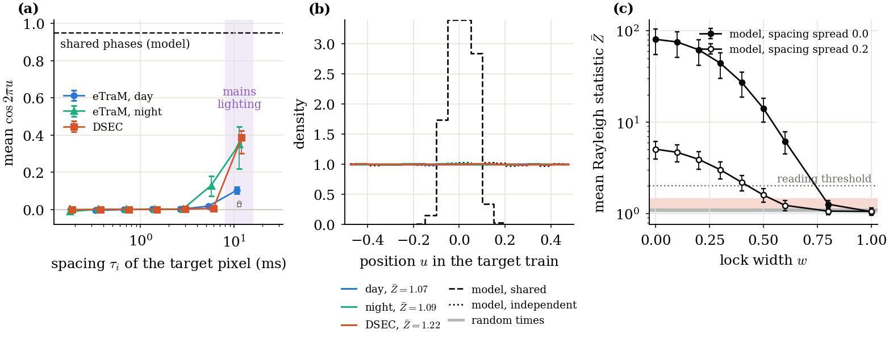

```
directive: 030
status: DONE
executed_commit: 7ecc737
results: results/paper/fig_phase4.{pdf,png}; fig_scaling.pdf, fig_coding_cost.pdf, fig_task.pdf rewritten
         (all four JSON unchanged)
```

## 1. What ran

1. **Script (D-030-1).** `scripts/fig_029.py` was replaced with Appendix A, as the text between the fence
   lines plus one newline. Its SHA-256 matches Section 4. The only change from `caf042f` is the x label of
   `fig_phase4` panel (c), from "lock width $w$ (0: shared, 1: independent)" to "lock width $w$".
2. **Figures** on the laptop (matplotlib 3.10.9), from committed files only:

   ```
   python3 scripts/fig_029.py --st results/st --pc results/pc --pc2 results/pc2 --hc results/hc --paper results/paper --out results/paper
   ```
3. **Suite** on `cnt` at `7ecc737`: 185 tests, 0 failures, 0 errors, 0 skipped (from `--junitxml`). Before it
   ran, the committed `results/{pc,pc2,hc,paper,td2,hd,st}` were copied into the host checkout, since
   `scripts/sync_cnt.sh` never sends `results/`.

## 2. Acceptance checks

| # | check | outcome |
|---|---|---|
| 1 | SHA-256 of Section 4; suite passes with no skipped test | **PASS**. `981c69b8...61b37a68`. Suite at `7ecc737` on `cnt`: 185 tests, 0 failures, 0 errors, 0 skipped, after copying the committed results into the host checkout |
| 2 | the JSON of `fig_scaling`, `fig_phase4`, `fig_coding_cost` and `fig_task` byte-identical to `caf042f` | **PASS**. `git diff --quiet caf042f -- results/paper/<fig>.json` is empty for all four |
| 3 | only the PDF and PNG files of the four figures changed under `results/` | **PASS**. `git diff --stat caf042f 7ecc737 -- results` lists `fig_phase4.pdf`, `fig_phase4.png`, `fig_scaling.pdf`, `fig_coding_cost.pdf` and `fig_task.pdf`. The three unchanged figures' PDFs keep their size; their PNGs are byte-identical, so the PDF difference is presumably the creation timestamp matplotlib writes, not content. Nothing else under `results/` changed |

## 3. The new panel (c)

Panel (c) is on the right of `fig_phase4`. Its x label "lock width $w$" now lies inside the figure. The meaning
of the two ends (0: shared phases, 1: independent phases) is left to the manuscript's caption.


